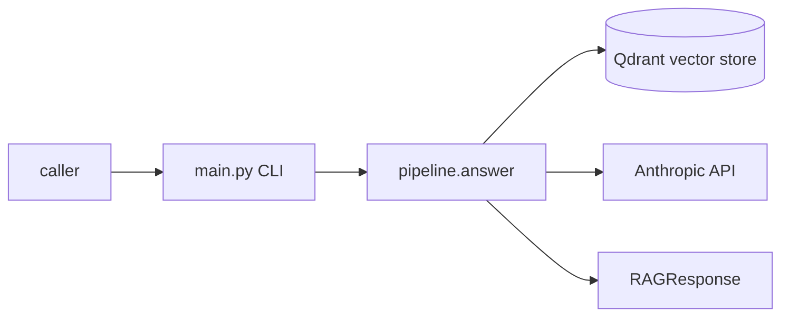
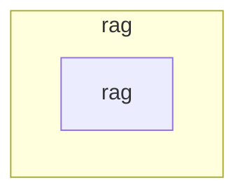

# rag — Architecture overview

> The durable, high-level map of the system: what the architect judges designs
> against, and the first thing a fresh session reads to understand the shape.
> Generated at bind time; kept honest via `/forge:architecture` (verify + sync).
> This file describes what IS — aspirations belong in issues and plans, never here.

## System context

Only the API path exists. Container sessions, routing and the Nomad agent are not implemented yet (#8).

Evidence:
- caller -> CLI: `main.py` `run` prints one `RAGResponse` JSON document, or ends with a `<code>: <message>` line on failure.
- CLI -> pipeline: `rag_api_fallback.py` `ApiPath.answer` calls `pipeline.answer`.
- pipeline -> Qdrant: `retriever.py` `QdrantRetriever` (query embedded on the host by fastembed; pinned model revision requested from `RAG_EMBED_ENDPOINT`). External; `QDRANT_URL`, `QDRANT_COLLECTION`.
- pipeline -> Anthropic: `provider.py` `AnthropicProvider` over HTTPS to `RAG_PROVIDER_BASE_URL`. Queries and retrieved chunk text leave the host.
- Both external systems sit behind the `Retriever` and `Provider` interfaces (rule 5).

## Zones & boundaries

## Zone index

### zone: rag
- **Root**: `.` · **Canon**: `CLAUDE.md` · **Stack**: `python` · **Steward**: generic developer
- **Owns**: routing queries to a Nomad container session or the API fallback and returning a normalized `RAGResponse` (routing and the container path are not implemented; the API path is)
- **Depends on**: Qdrant (`retriever.py`), Anthropic API (`provider.py`), Hugging Face hub for the pinned embedding model (`retriever.py`)
- **Depended on by**: unmapped: no caller beyond the `main.py` CLI yet

## Cross-zone contracts

Single zone; no cross-zone contracts.

## Data & async

- **Stores**: none owned; reads the external Qdrant collection (point payload keys `text`, `source_id`)
- **Queues / jobs**: unmapped: no code yet
