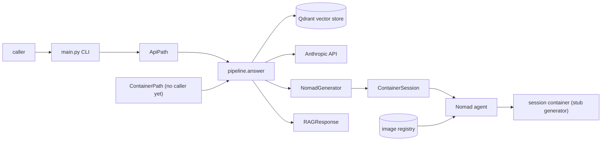
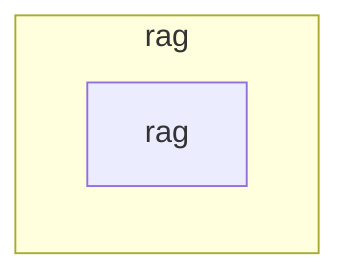

# rag — Architecture overview

> The durable, high-level map of the system: what the architect judges designs
> against, and the first thing a fresh session reads to understand the shape.
> Generated at bind time; kept honest via `/forge:architecture` (verify + sync).
> This file describes what IS — aspirations belong in issues and plans, never here.

## System context

Two generation paths exist: the API path (`ApiPath`, the one `main.py` runs) and the container path (`ContainerPath`, a Nomad session container). Routing between them and the pool are not implemented (#12); today `main.py` always runs the API path and only tests run the container path. Both end in `pipeline.answer` and the same `RAGResponse`.

Evidence:
- caller -> CLI: `main.py` `run` prints one `RAGResponse` JSON document, or ends with a `<code>: <message>` line on failure.
- CLI -> pipeline: `rag_api_fallback.py` `ApiPath.answer` calls `pipeline.answer`.
- pipeline -> Qdrant: `retriever.py` `QdrantRetriever` (query embedded on the host by fastembed; pinned model revision requested from `RAG_EMBED_ENDPOINT`). External; `QDRANT_URL`, `QDRANT_COLLECTION`.
- pipeline -> Anthropic: `provider.py` `AnthropicProvider` over HTTPS to `RAG_PROVIDER_BASE_URL`. Queries and retrieved chunk text leave the host.
- Both external systems sit behind the `Retriever` and `Provider` interfaces (rule 5).
- container path -> pipeline: `rag_container_path.py` `ContainerPath.answer` calls `pipeline.answer` with a `NomadGenerator` (a `Provider`) inside a `ContainerSession`; retrieval stays on the host (rule 6). `main.py` does not use it.
- pipeline -> Nomad agent: `container_generator.py` `NomadGenerator.generate` -> `container_session.py` `ContainerSession.run` -> `nomad_client.py` `NomadClient` (direct HTTP over `httpx`, `NOMAD_ADDR`, optional `NOMAD_TOKEN`/`NOMAD_CACERT`/`NOMAD_NAMESPACE`). External; its queries and chunks leave the host only to this agent. Provisioning it is out of scope.
- Nomad agent -> registry -> container: the agent pulls `RAG_CONTAINER_IMAGE` (digest-pinned, built from the root `Dockerfile`) and runs `container/entrypoint.py`, a deterministic stub (rule 7). The registry is external.
- A container failure is an internal `ContainerError`; `pipeline.answer` turns it into the fixed `ProviderError` (callers keep seeing only `RAGResponse` or `RAGError`).

## Zones & boundaries

## Zone index

### zone: rag
- **Root**: `.` · **Canon**: `CLAUDE.md` · **Stack**: `python` · **Steward**: generic developer
- **Owns**: routing queries to a Nomad container session or the API fallback and returning a normalized `RAGResponse` (routing and the container pool are not implemented, #12; the API path and a one-session-per-query container path are)
- **Depends on**: Qdrant (`retriever.py`), Anthropic API (`provider.py`), Hugging Face hub for the pinned embedding model (`retriever.py`), a Nomad agent and an image registry (`nomad_client.py`, container path)
- **Depended on by**: unmapped: no caller beyond the `main.py` CLI (API path only) yet; `ContainerPath` is exercised by tests only

## Cross-zone contracts

Single zone; no cross-zone contracts.

## Data & async

- **Stores**: none owned; reads the external Qdrant collection (point payload keys `text`, `source_id`)
- **Queues / jobs**: one Nomad batch job per container query, no queue.
  - Job (`nomad_client.py` `build_job`): id `rag-session-<uuid4>`, `Meta` `rag=session` plus a per-process `rag_instance`, one group, `Count=1`, no restart and no reschedule, optional `NOMAD_NAMESPACE`. One docker task `gen`: `network_mode="none"` (no group `Networks` block: it fails every allocation), `readonly_rootfs`, `cap_drop=["ALL"]`, `no-new-privileges`, `pids_limit`, numeric user 65532, `cpu_hard_limit`, no volumes or mounts, no `memory_max`; CPU and memory from `RAG_CONTAINER_CPU_MHZ`/`RAG_CONTAINER_MEMORY_MB`; log and ephemeral disk caps.
  - Input: base64 of `{"query", "chunks":[{"id","text"}]}` in the template `EmbeddedTmpl` (`local/input.json`, so Nomad's template engine never evaluates user text), capped by `RAG_CONTAINER_MAX_INPUT_BYTES`; the entrypoint deletes the file after reading.
  - Output, stdout v1 (`normalizer.py` `parse_container_output`): exactly one JSON line `{"v":1,"answer":str,"input_tokens":int,"output_tokens":int}`, at most `RAG_CONTAINER_MAX_OUTPUT_BYTES`; anything else is a `ContainerError`.
  - Lifecycle (`container_session.py`): a hard deadline from `RAG_CONTAINER_TIMEOUT_S`; an unplaceable evaluation fails at once (a session never waits for capacity); exit status is read from task events. The job is purged (`DELETE /v1/job/<id>?purge=true`, a bounded wait for no running allocation, best-effort allocation GC) on success and on every failure path; a failed purge never masks the original error. One session serves one run (#9 changes that).
  - Not covered yet: purge on SIGINT/SIGTERM or `kill -9` (#11); a leaked job stays until Nomad removes it.
