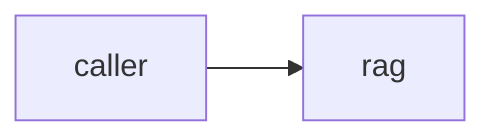
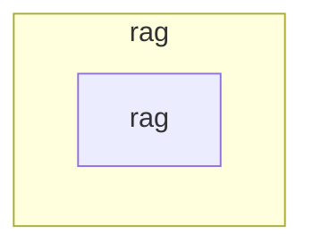

# rag — Architecture overview

> The durable, high-level map of the system: what the architect judges designs
> against, and the first thing a fresh session reads to understand the shape.
> Generated at bind time; kept honest via `/forge:architecture` (verify + sync).
> This file describes what IS — aspirations belong in issues and plans, never here.

## System context

No code exists yet. unmapped: no implementation to evidence; external systems (Nomad agent, vector store, LLM provider) are assumptions recorded in the constitution, not dependencies.

## Zones & boundaries

## Zone index

### zone: rag
- **Root**: `.` · **Canon**: `CLAUDE.md` · **Stack**: `python` · **Steward**: generic developer
- **Owns**: routing queries to a Nomad container session or the API fallback and returning a normalized `RAGResponse`
- **Depends on**: unmapped: no code yet
- **Depended on by**: unmapped: no code yet

## Cross-zone contracts

Single zone; no cross-zone contracts.

## Data & async

- **Stores**: unmapped: no code yet
- **Queues / jobs**: unmapped: no code yet
